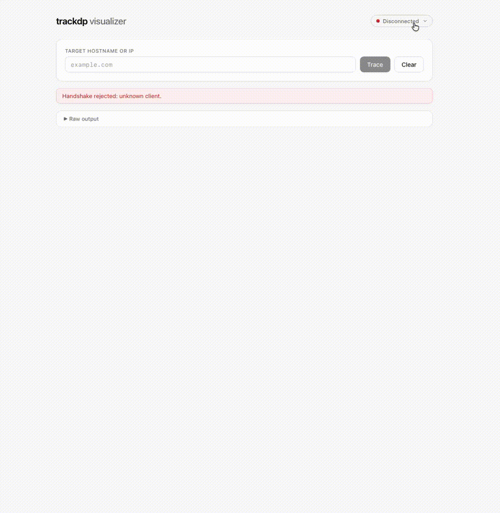

# trackdp — Run a traceroute and watch every hop live
> ⚠️ **SECURITY WARNING** — the agent runs `traceroute` / `tracert` **on the machine
> it is running on**, and every trace is **triggered over WebSocket**. Anyone who can
> reach the WebSocket endpoint (and pass the handshake) can make the agent execute
> these commands locally. It binds to `127.0.0.1` and only accepts the configured
> visualizer origin by default, but that is **not** a real security boundary.
> **Do not expose it to untrusted networks and do not use it in production.**


## What is trackdp?

trackdp is a small monorepo with two apps that work together to run a `traceroute`
and turn the output into a clean, interactive view:

| Package | Path | What it does |
| --- | --- | --- |
| **trackdp-agent** | [`trackdp-agent`](trackdp-agent) | WebSocket server that runs `traceroute` (or `tracert` on Windows) and streams the output |
| **trackdp-visualizer** | [`trackdp-visualizer`](trackdp-visualizer) | Next.js UI that connects to the agent, performs the handshake, and renders the traces |

The demo GIF shows the visualizer after tracing **example.com**: the summary
stats, the response-time chart, the route from source to destination, and the raw
traceroute output.

<p>
  
</p>

## Features

- **Live streaming** — each hop line appears as soon as `traceroute` emits it.
- **Response-time chart** — latency per hop, with a hover tooltip (avg / min / max).
- **Route map** — start → hop → … → destination, including timeouts and resolved hostnames.
- **Summary stats** — hop count, average response time, and destination reached/unreached.
- **Cross-platform** — auto-detects `traceroute` (macOS/Linux) vs. `tracert` (Windows).
- **Handshake protection** — the agent only accepts clients that identify as the visualizer.
- **Resilient port handling** — a busy port automatically falls back to the next free one.

## Tech stack

- **Node.js** — JavaScript runtime (>= 18.17)
- **Next.js 14** — React framework powering the visualizer UI
- **pnpm** — fast, disk-space-efficient package manager with workspace support
- **ws** — WebSocket server/client library behind the trackdp-agent

## Requirements

- **Node.js** `>= 18.17`
- **pnpm** `12.15.0` (bootstrapped via Corepack when missing)

## Installation

### One-shot installer (recommended)

The installer detects Node.js and pnpm, installs anything that's missing, fetches the
dependencies, and then launches the interactive setup wizard:

```bash
# macOS / Linux
./install.sh

# Windows (PowerShell)
.\install.ps1
```

### Manual installation

```bash
# 1. Verify the environment (Node.js + pnpm; pnpm is bootstrapped via Corepack if missing)
pnpm run check

# 2. Install dependencies
pnpm install

# 3. Run the setup wizard (asks for the visualizer URL and port)
pnpm run setup
```

### Setup wizard

`pnpm run setup` performs the following steps, in order:

1. Verifies Node.js and pnpm (bootstraps pnpm via Corepack when missing).
2. Runs `pnpm install`.
3. Asks for the **visualizer URL** (default `http://localhost:3000`).
4. Asks for the **WebSocket port** (default `8787`).
5. If the port is taken, offers the next free port.
6. Checks that the URL actually identifies itself as the trackdp-visualizer (HTTP reachability + the `trackdp` marker).
7. Runs a real **WebSocket handshake self-test** against a throwaway agent.
8. Writes the agent config and points the visualizer at the agent.

Config files produced (both git-ignored):

- `trackdp-agent/trackdp.config.json` — agent settings
- `trackdp-visualizer/.env.local` — `NEXT_PUBLIC_AGENT_WS_URL` used by the visualizer

## Running

| Command | Description |
| --- | --- |
| `pnpm run agent` | starts the **trackdp-agent** only |
| `pnpm run visualizer` | starts the **trackdp-visualizer** only (Next.js dev server) |
| `pnpm run dev` | starts **both** in parallel (development) |
| `pnpm run build` | production build of the trackdp-visualizer |
| `pnpm run check` | verifies the environment (Node.js + pnpm) |

Then open the visualizer at [`http://localhost:3000`](http://localhost:3000), enter a
hostname (e.g. `example.com`), and click **Trace**.

## Configuration

`trackdp-agent/trackdp.config.json`:

```json
{
  "visualizerUrl": "http://localhost:3000",
  "host": "127.0.0.1",
  "port": 8787,
  "protocol": 1,
  "handshakeTimeoutMs": 5000
}
```

The agent is dynamic at startup too: if the configured port is taken, it automatically
falls back to the next available port and logs the change.

## WebSocket protocol

The agent binds on `ws://127.0.0.1:<port>`. Every client must complete a **handshake**
before any command is accepted.

### 1. Handshake

The agent greets first:

```json
{ "type": "hello", "app": "trackdp-agent", "protocol": 1, "version": "1.0.0" }
```

The client answers:

```json
{ "type": "hello", "app": "trackdp-visualizer", "protocol": 1 }
```

If `app` and `protocol` match, the agent replies:

```json
{ "type": "ready", "agent": "trackdp-agent", "protocol": 1 }
```

If the client fails to answer within `handshakeTimeoutMs` (default 5000 ms), or sends
the wrong identity, the connection is closed (`4001`/`4002`/`4003`). Browser clients are
additionally checked against the configured visualizer `Origin`.

### 2. Trace

```json
{ "type": "trace", "target": "example.com" }
```

The agent streams output line by line:

```json
{ "type": "line", "line": " 1  192.168.1.1 ..." }
```

…and finishes with:

```json
{ "type": "done", "code": 0 }
```

Errors are sent as:

```json
{ "type": "error", "message": "..." }
```

## Project structure

```
trackdp/
├── trackdp-agent/             # WebSocket server (runs traceroute)
│   ├── agent.mjs              # entry point
│   ├── setup.mjs              # setup wizard
│   ├── lib/                   # config, ports, env helpers
│   └── scripts/               # check-env
├── trackdp-visualizer/        # Next.js UI
│   └── app/
│       ├── page.jsx           # main page
│       ├── components/        # LatencyChart, RouteMap
│       └── lib/               # trace parser & hooks
├── install.sh                 # one-shot installer (macOS/Linux)
├── install.ps1                # one-shot installer (Windows)
├── example.gif                # demo recording
├── package.json               # workspace scripts
└── pnpm-workspace.yaml
```

## Troubleshooting

| Problem | Fix |
| --- | --- |
| Agent won't start | Run `pnpm run check` and make sure Node.js `>= 18.17` is installed |
| Port already in use | The agent falls back to the next free port automatically (see log) |
| Visualizer shows "Disconnected" | Is the agent running? Does the WS URL match? (status gear in the top right → change URL → Connect) |
| Connection is rejected | The visualizer runs on a different origin than configured — rerun `pnpm run setup` |
| `pnpm` not found | Run `npm install -g pnpm`, or via Corepack: `corepack enable && corepack prepare pnpm@12.15.0 --activate` |

## License

Licensed under the [MIT License](LICENSE). This project is provided as an example —
feel free to use it as a starting point for your own applications.
